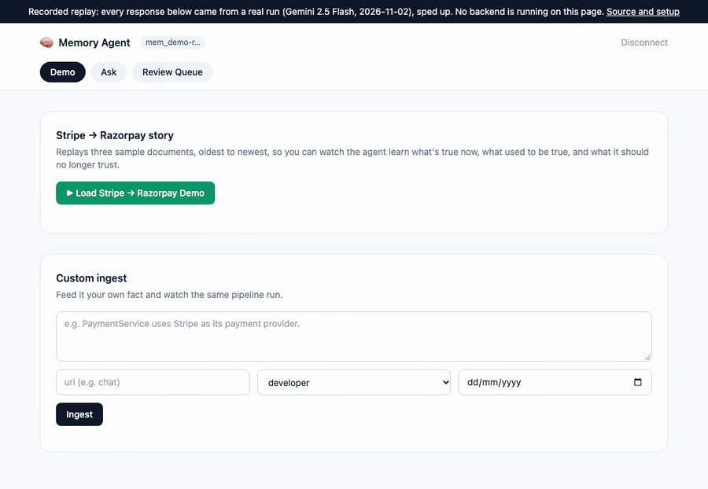
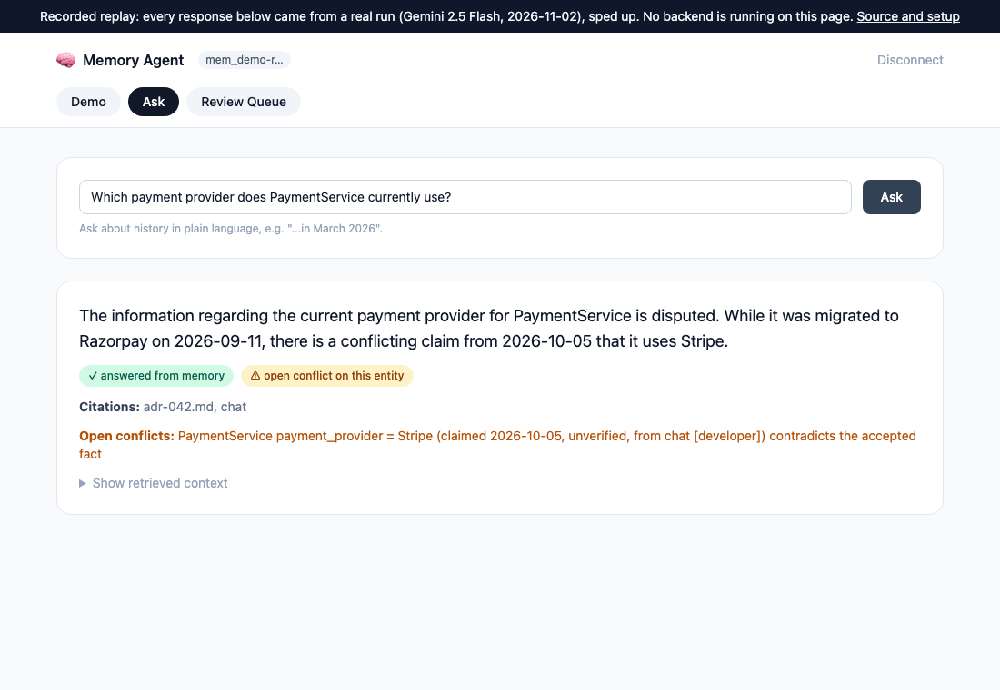
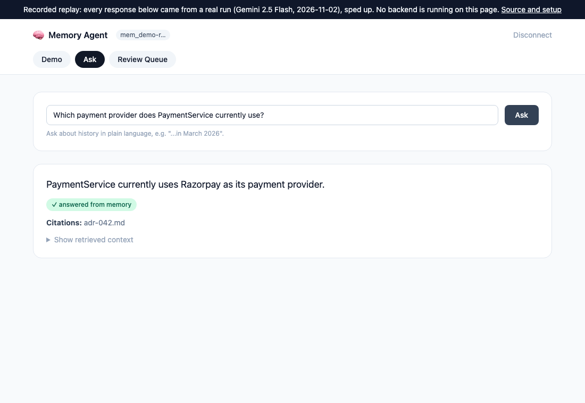

# Enterprise Engineering Memory Agent

[](https://github.com/sampro14/enterprise_engineering_memory_agent/actions/workflows/ci.yml)
[](https://sampro14.github.io/enterprise_engineering_memory_agent/)

[](LICENSE)

Persistent, temporal, confidence-aware **organizational memory for AI agents**: it tracks *what is true now, what was
true before, and what to distrust*, and learns lessons from repeated failures.

Engineering facts change, and old documents don't announce that they're out of date. Vector search returns whatever text
matches, so an agent can confidently repeat a decision that was reversed months ago. This system stores facts with validity
dates, source authority and evidence, so an agent can tell which fact is current, what it replaced, and which claims are
still unverified.

**[Live demo](https://sampro14.github.io/enterprise_engineering_memory_agent/)** · [Design document](docs/DESIGN.md) ·
[Evaluation report](docs/POC_REPORT.md)

## Demo

**[Try it in your browser](https://sampro14.github.io/enterprise_engineering_memory_agent/)**: no install or API key. The
page runs the real UI and replays responses recorded from a real run, so only the recorded story and questions work there.



A service moves from Stripe to Razorpay, then a developer casually says it "still uses Stripe":

1. **Learns from documents.** Three sample documents are ingested oldest to newest. Facts get validity dates, and the
   migration closes the old Stripe and PostgreSQL facts instead of deleting them.
2. **Answers across time.** "Which provider in March 2026?" returns Stripe, from history.
3. **Distrusts weak claims.** The newer developer message has lower authority than the architecture decision record, so it
   doesn't overwrite the fact. It's stored as a conflict, surfaced in answers, and sent for human review.
4. **Resolves with a human.** Once the claim is rejected, the same question returns Razorpay with no conflict.

| Conflict open | After the claim is rejected |
|---|---|
|  |  |

### Results

On a synthetic benchmark of about 60 documents and 147 questions per system (held-out seeds, same LLM and prompt for all):

| Metric | Vector RAG | All docs in context | This system |
|---|---|---|---|
| Overall accuracy | 82% | 93% | **95%** |
| Current-fact accuracy | 58% | 100% | **100%** |
| Stale or poisoned answers (lower is better) | 43% | 16% | **14%** |

It clearly beats vector RAG, but the gap over putting every document in context is within noise at this size, and it uses
3.2x the LLM calls of the baselines. Experience memory **lost** to simple conversation history on repeated mistakes (77% vs
91% task success). The [PoC report](docs/POC_REPORT.md) has the details and the next experiment.

## What's in it

- **Temporal facts:** every fact has a validity window, so questions can be answered as of any date, and history is kept
  rather than overwritten.
- **Source authority and conflict handling:** weak claims can't overwrite accepted facts; they go to a human review queue.
- **Entity resolution:** aliases such as `payments-svc` and `payment service` map to one entity, and merges are reversible.
- **Service design:** REST API, tenant-scoped API keys, and an async ingest queue whose workers claim jobs with
  `SKIP LOCKED`, retrying with backoff.
- **Swappable backends:** Postgres + pgvector or SQLite behind one store interface, with every store, domain and API test
  run on both. Gemini, Anthropic and OpenAI sit behind one provider factory.
- **Measured, not assumed:** benchmarks against four baselines with held-out seeds, programmatic grading and confidence
  intervals.

**Stack:** Python 3.12, FastAPI, LangGraph, PostgreSQL + pgvector, SQLite, Docker Compose, GitHub Actions.

## Architecture

```
client --HTTP--> FastAPI (API key -> tenant) --> MemoryService --> LangGraph flows --> store (Postgres+pgvector | SQLite)
                     |                                 |                                          ^
                     +-- POST /ingest --> jobs table --> worker (claims with SKIP LOCKED) ---------+
providers: create_llm() / create_embedder()  ->  gemini | anthropic | openai | fake   (retries + cache applied once)
```

## Quickstart

### A. Everything in Docker (Postgres + pgvector, API, worker)

```bash
cp .env.example .env            # set GOOGLE_API_KEY (or ANTHROPIC_API_KEY / OPENAI_API_KEY and LLM_PROVIDER)
make up                         # db, migrations, api (http://localhost:8090/docs), worker
make tenant NAME=acme           # prints a tenant id and an API key (shown once)
```

```bash
KEY=mem_...                     # from `make tenant`
curl -s localhost:8090/api/v1/ingest -H "Authorization: Bearer $KEY" -H 'content-type: application/json' -d '{
  "text": "PaymentService uses Stripe as its payment provider.", "uri": "arch.md",
  "source_type": "official_docs", "doc_date": "2025-02-01"}'          # -> 202 {"job_id": "...", "status_url": "..."}
curl -s localhost:8090/api/v1/agent/ask -H "Authorization: Bearer $KEY" -H 'content-type: application/json' \
  -d '{"question": "Which payment provider does PaymentService use?"}'
```

`make e2e` runs a full live scenario over HTTP (ingest through the queue, temporal questions, alias resolution, a poisoning
claim landing in review, the review decision, tenant isolation, and the two-phase task flow). Interactive docs: `/docs`.

A lightweight demo UI (no build step) is served at `http://localhost:8090/` — paste the API key from `make tenant` to
connect, then replay the Stripe → Razorpay story, ask questions, and work the review queue from the browser. It calls the
same `/api/v1` routes above, so it needs both the API and a worker running (`make up` starts both).

### B. Local, no infrastructure (SQLite)

```bash
make setup                      # uv sync, creates .env
uv run pytest                   # offline: fake providers, no network
uv run memory-agent demo        # Stripe -> Razorpay story with real LLM calls
uv run memory-agent ingest docs/adr-042.md --source-type architecture_repo --date 2026-09-15
uv run memory-agent ask "Which payment provider does PaymentService use now?" --show-context
uv run memory-agent timeline PaymentService
```

Leave `DATABASE_URL` empty to use SQLite (`MEMORY_DB`); set it to use Postgres.

## LLM providers (factory)

`LLM_PROVIDER` and `EMBED_PROVIDER` are independent, so Claude can generate while Gemini or OpenAI embeds.

| Provider | LLM | Embeddings | Status |
|---|---|---|---|
| `gemini` | yes | yes | **live-tested** (default) |
| `anthropic` | yes | no (Anthropic has no embeddings API) | contract-tested with mocked SDK; not live-tested |
| `openai` | yes | yes | contract-tested with mocked SDK; not live-tested |
| `fake` | scripted | hashed bag-of-words | offline tests, CI |

Add one by writing an adapter and `@register_llm("name")` in [llm/factory.py](src/memory_agent/llm/factory.py). Retries and the
on-disk response cache (`LLM_CACHE`) are applied by the factory, not by adapters. `EMBED_DIM` (default 3072) must match the
vector column; changing it needs a new migration.

## API (design section 26)

All `/api/v1` routes need `Authorization: Bearer <key>`; the tenant comes from the key, never from the body.

| Area | Endpoints |
|---|---|
| Ingest (async) | `POST /ingest` -> 202 + job, `GET /jobs/{id}`, `GET /jobs` |
| Memories | `POST /memories` (sync), `POST /memories/search`, `GET /memories/{id}/history`, `POST /memories/{id}/verify`, `POST /memories/{id}/invalidate`, `DELETE /memories/{id}` |
| Entities | `GET /entities?name=`, `GET /entities/{id}`, `GET /entities/{id}/graph?as_of=`, `POST /entities/{id}/merge`, `POST /entities/merges/{id}/revert` |
| Review | `GET /conflicts`, `GET /reviews`, `POST /reviews/{id}/decision` |
| Agent | `POST /agent/ask`, `POST /agent/tasks`, `GET /agent/tasks/{id}`, `POST /agent/tasks/{id}/outcome`, `GET /tasks/{id}/memory-context` |
| System | `GET /healthz`, `GET /readyz` (database, migrations, provider configuration) |

Errors are `{"error", "detail", "request_id"}` with 401/404/409/422 and 502/503 for provider failures; every response carries
`X-Request-ID`. Logs are JSON on stdout.

Deviations from the design's API: ingestion is one endpoint (`POST /ingest`) instead of `sources` + `run`; tasks are two-phase
(plan, then report the outcome) because execution happens outside the memory service.

## Layout

| Path | What |
|---|---|
| `src/memory_agent/api/` | FastAPI app, auth, schemas, routers |
| `src/memory_agent/services/memory_service.py` | every operation, tenant-scoped; used by CLI, API and worker |
| `src/memory_agent/graph.py` | the LangGraph workflow: ask / plan / execute / outcome (design 27) |
| `src/memory_agent/store/` | store interface, SQLite and Postgres backends, portable schema, migrations |
| `src/memory_agent/llm/` | provider factory, adapters, retry/cache decorators |
| `src/memory_agent/{ingest,extraction,entities,validation,consolidation,retrieval,temporal,confidence}.py` | memory pipeline (design 9, 14-17) |
| `src/memory_agent/{episodes,experience,task_agent}.py` | reflection and experience learning (design 19) |
| `src/memory_agent/{jobs,worker,tenants}.py` | job queue, worker, API keys |
| `eval/`, `docs/POC_REPORT.md` | benchmarks and results |
| `demo/`, `scripts/record_demo.py` | hosted recorded replay and the script that re-records it; `make demo-site` builds it |

## Development

```bash
make test               # offline unit tests (SQLite + fake providers)
make test-integration   # same domain, API and queue tests on Postgres (docker compose up -d db)
make lint
make db-shell           # psql into the compose database
```

Every store, domain and API test runs on **both** SQLite and Postgres (the Postgres variants are marked `integration`),
plus a schema-parity test. CI (`.github/workflows/ci.yml`) runs lint, the offline suite, and the Postgres suite against a
pgvector service container.

Operational notes: writes are atomic per document (a failed job leaves nothing half-written); concurrent writers of one
tenant are serialized with a Postgres advisory lock; jobs are retried with exponential backoff, and a job whose worker
died is reclaimed after `JOB_VISIBILITY_TIMEOUT_SECONDS`. Containers run as a non-root user.

## Evaluation

```bash
# temporal facts, contradictions, poisoning, aliases, out-of-order ingestion (seed 0 = development; use 1+ for held-out)
uv run python -m eval.run_eval --seeds 3 --first-seed 1 --systems A,B,BF,C,F
# repeated mistakes on a deployment simulator with hidden organization-specific rules
uv run python -m eval.experience_eval --seeds 3 --first-seed 1 --tasks 24 --systems A,B,C,F
```

Systems: **A** no memory, **B** conversation history, **BF** all documents in context, **C** vector RAG, **F** the full memory
system. Same LLM, prompt and answer schema for all; programmatic grading. See [docs/POC_REPORT.md](docs/POC_REPORT.md) for
results and, importantly, what they do not show (small worlds, synthetic data, experience memory lost to simple baselines).

## Known limitations

- No row-level security in Postgres (tenant scoping is enforced in the store layer and tested, not by the database).
- Deletion propagation is basic: a deleted memory's evidence text and vectors are purged, but derived experiences are not
  re-verified. There are no ACLs on individual memories yet.
- Dates are day-granular. One LLM provider is live-tested. Review approval supports conflicts and agent-inference candidates.
- Ingestion takes text; git/CI/incident connectors are not built.

## Roadmap

1. Scale experiment: grow the benchmark to thousands of documents, where context stuffing should degrade, and test whether
   structured memory holds up.
2. Diagnose why distilled lessons lose to raw history, then test injecting failed episodes alongside lessons.
3. Add a machine-readable `disputed_values` field to answers.
4. Build git, CI and incident connectors, plus per-memory ACLs.

## License

[MIT](LICENSE)
